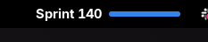

# Sprint Indicator (GNOME Shell Extension)

Shows the current sprint number and sprint progress in the GNOME Shell
top bar.


## Screenshot



Clicking the indicator opens a menu with the sprint's date range, the day
within the sprint, days remaining, and a shortcut to the settings.

## How it works

The extension computes sprints with plain date arithmetic — no network, no
login. You configure:

- **Start date** — the date a known sprint began (e.g. `2026-11-12`)
- **Sprint length** — in weeks (1–8)
- **Sprint number at start date** — e.g. if sprint 42 began on the start
  date, set 42

The current sprint number and progress are derived from those. The
indicator refreshes itself just after midnight each night.

## Display modes

Configurable in *Sprint Settings…*:

| Mode | Top bar shows |
|---|---|
| Day counter | `Sprint 140 · Day 14/14` |
| Progress bar | `Sprint 140 ▓▓▓░░░░░` — empty on day 1, full on the last day |
| Sprint number only | `Sprint 140` |

## Installation

```bash
./install.sh
```

This copies the extension to
`~/.local/share/gnome-shell/extensions/sprint-indicator@micho/` and compiles
its GSettings schema.

Then restart GNOME Shell (**log out and back in** on Wayland, or `Alt-F2` →
`r` on X11) and enable it:

```bash
gnome-extensions enable sprint-indicator@micho
```

## Configuration

Click the indicator in the top bar and choose **Sprint Settings…**, or run:

```bash
gnome-extensions prefs sprint-indicator@micho
```

Settings can also be set from the command line:

```bash
DIR=~/.local/share/gnome-shell/extensions/sprint-indicator@micho/schemas
gsettings --schemadir "$DIR" set org.gnome.shell.extensions.sprint-indicator start-date "2026-11-12"
gsettings --schemadir "$DIR" set org.gnome.shell.extensions.sprint-indicator first-sprint-number 140
gsettings --schemadir "$DIR" set org.gnome.shell.extensions.sprint-indicator sprint-length-weeks 2
gsettings --schemadir "$DIR" set org.gnome.shell.extensions.sprint-indicator sprint-display "bar"
```

## Compatibility notes

- The indicator itself works on GNOME Shell 45 and newer.
- The settings dialog requires **GNOME Shell 49+**: GNOME 49 moved the
  `ExtensionPreferences` module to a new resource path
  (`resource:///org/gnome/Shell/Extensions/js/extensions/prefs.js`), and
  `prefs.js` uses that path. On GNOME 45–48 the top bar indicator works,
  but the settings dialog fails to load — configure via `gsettings`
  instead (see above).

## Files

| File | Purpose |
|---|---|
| `extension.js` | Panel button, progress bar, sprint calculation, midnight refresh |
| `prefs.js` | Settings dialog (GTK4 / libadwaita) |
| `schemas/*.gschema.xml` | GSettings schema |
| `install.sh` | Install for the current user |

## Development notes

- The progress bar is a Cairo-drawn `St.DrawingArea`; its size and colors
  are the `BAR_*` constants at the top of `extension.js`.
- After editing any file, re-run `./install.sh` and restart GNOME Shell
  (log out/in on Wayland) to load the new code.
- Debug errors with `journalctl -f /usr/bin/gnome-shell`.

## Uninstallation

```bash
gnome-extensions disable sprint-indicator@micho
rm -rf ~/.local/share/gnome-shell/extensions/sprint-indicator@micho
```

## License

MIT
